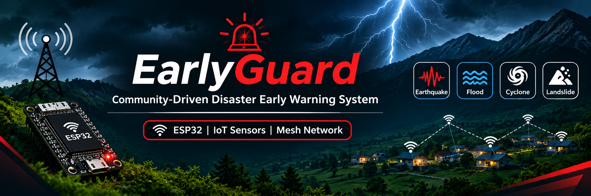
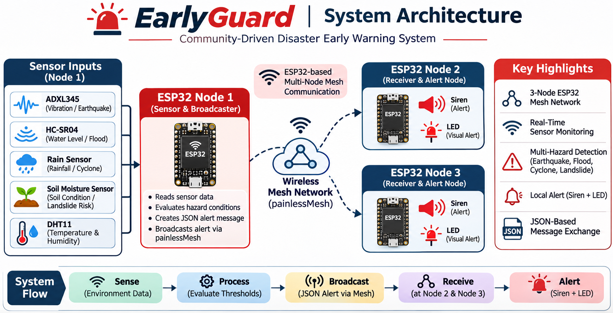
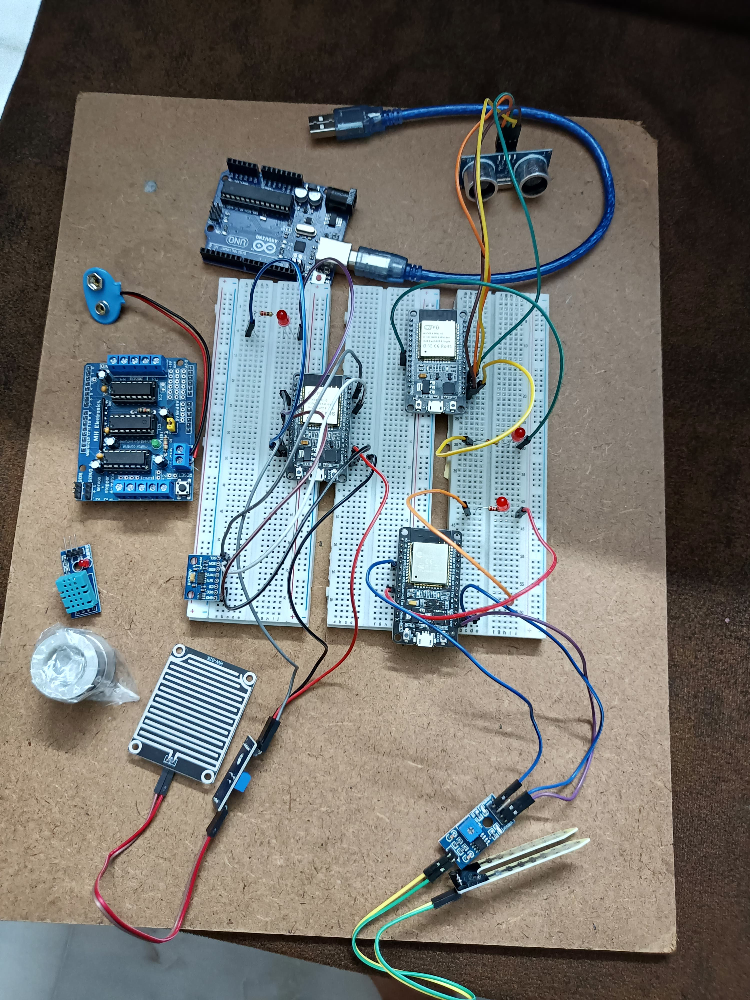

<p align="center">
  
</p>
<p align="center">
  <h1 align="center">🚨 EarlyGuard</h1>
  <p align="center">
    Community-Driven Disaster Early Warning System
  </p>
  <p align="center">
    ESP32 • IoT Sensors • Wireless Mesh Network
  </p>
</p>

---

## About the Project

EarlyGuard is an IoT-based disaster early warning prototype designed to monitor environmental conditions and distribute local alerts through an ESP32-based wireless mesh network.

The project aims to explore how interconnected sensor nodes can support early awareness of potential hazards, particularly in rural and remote areas where reliable internet connectivity may be limited.

## Key Features

- **Wireless Mesh Communication:** Uses painlessMesh for communication between ESP32 nodes.
- **Environmental Monitoring:** Collects sensor data for vibration, rainfall, soil moisture, water-level distance, temperature and humidity.
- **Local Warning System:** Uses LEDs and sirens to provide visual and audible alerts.
- **JSON-Based Messaging:** Shares sensor and alert information between nodes.
- **Multi-Node Architecture:** Uses one sensor node and two receiver nodes.

## System Architecture

| Node | Function |
|---|---|
| ESP32 Node 1 | Sensor monitoring, alert evaluation and mesh broadcasting |
| ESP32 Node 2 | Receives mesh alerts and activates local warnings |
| ESP32 Node 3 | Receives mesh alerts and activates local warnings |



## Project Demonstration

The following photograph showcases the implemented EarlyGuard hardware prototype.



### Demonstration Highlights
- Sensor-based environmental monitoring.
- ESP32 mesh communication between three nodes.
- Wireless transmission of alert messages.
- Local LED and siren-based warning system.

## Hardware Components

- 3 × ESP32 development boards
- ADXL345 accelerometer
- HC-SR04 ultrasonic sensor
- Rain sensor
- Soil moisture sensor
- DHT11 temperature and humidity sensor
- 3 × LEDs
- 3 × 5V sirens
- MOSFET/transistor driver circuits
- Breadboards and jumper wires

## Software and Technologies

- Arduino IDE
- Embedded C/C++
- painlessMesh
- ArduinoJson
- ESP32
- IoT and wireless mesh networking

## Repository Structure

```text
EarlyGuard/
│
├── Code/
│   ├── ESP32_Node_1/
│   │   └── ESP32_Node_1.ino
│   ├── ESP32_Node_2/
│   │   └── ESP32_Node_2.ino
│   └── ESP32_Node_3/
│       └── ESP32_Node_3.ino
│
├── Documentation/
│   └── HARDWARE_AND_UPLOAD_NOTES.md
│
├── README.md
├── LICENSE
└── .gitignore
```

## Mesh Network Configuration

The firmware uses the following mesh configuration:

| Parameter | Configuration |
|---|---|
| Mesh Name | `EarlyGuardMesh` |
| Mesh Password | `EarlyGuard123` |
| Mesh Port | `5555` |
| Communication | painlessMesh |
| Data Format | JSON |

## Getting Started

1. Clone or download this repository.
2. Open the required `.ino` file from the corresponding node folder in Arduino IDE.
3. Install the required libraries: painlessMesh, ArduinoJson, DHT sensor library, Adafruit Unified Sensor and Adafruit ADXL345.
4. Select the appropriate ESP32 board and port.
5. Upload the corresponding firmware to each ESP32 node.
6. Power the nodes and observe their mesh communication and warning outputs.

Refer to [Hardware and Upload Notes](Documentation/HARDWARE_AND_UPLOAD_NOTES.md) for additional information.

## Project Status

**Status:** Completed Working Prototype

The EarlyGuard prototype has been developed using three ESP32 nodes,
environmental sensors, wireless mesh communication, and local
LED and siren-based warning mechanisms.

## Limitations and Safety Disclaimer

EarlyGuard is an experimental academic prototype. It is not a certified disaster prediction or life-safety warning system.

Sensor thresholds require calibration and field validation. A landslide risk indicator represents sensor-based environmental conditions, not a confirmed prediction of a landslide.

## Future Scope

- Improve sensor calibration and alert reliability.
- Conduct extended mesh communication testing.
- Optimize power consumption for remote deployment.
- Expand the number of sensor and receiver nodes.
- Develop weather-resistant hardware enclosures.
- Perform field testing in different environmental conditions.

## Project Purpose

To explore an affordable, community-oriented approach to local disaster awareness using IoT sensors, ESP32 devices and wireless mesh networking.

---

**EarlyGuard – Building awareness through connected communities.**
## License

This project is licensed under the terms of the LICENSE file included in this repository.
